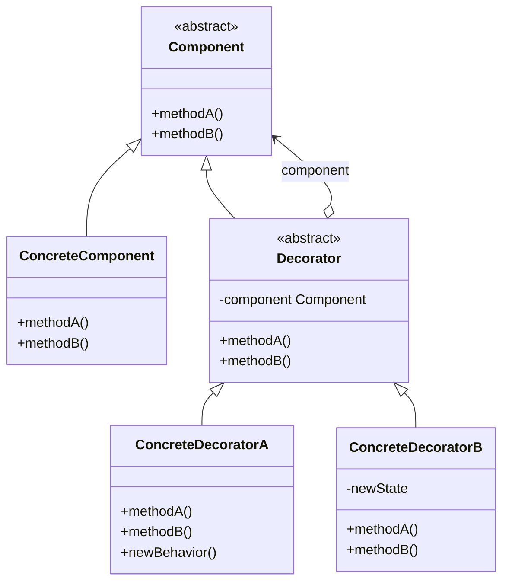
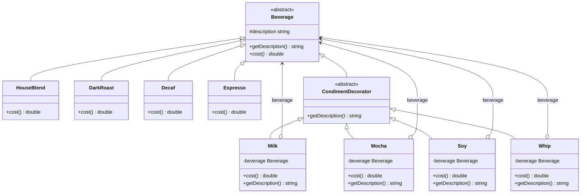

# 装饰者模式类图讲解

## 1. 定义装饰者模式

装饰者模式动态地把责任附加到对象上。若要扩展功能，装饰者提供比继承更有弹性的方案。

- 组件可单独使用，也可被装饰者包起来
- ConcreteComponent：被加上新行为的对象
- Decorator：公共抽象类，持有一个 Component
- 具体装饰者：可加新方法、新状态，在原行为前后追加计算

---

## 2. 星巴滋的类图

- Beverage 即 Component
- 左侧四种咖啡，各为一种具体组件
- 右侧 CondimentDecorator 为抽象装饰者
- Milk、Mocha、Soy、Whip 各持有一个 Beverage
- 调料同时实现 cost() 与 getDescription()

