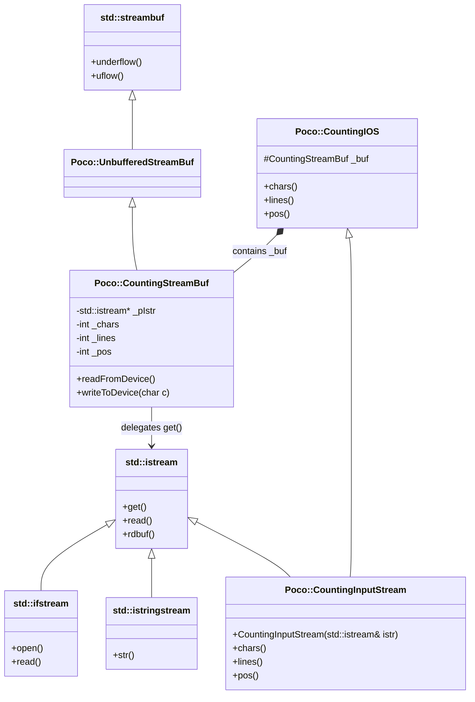
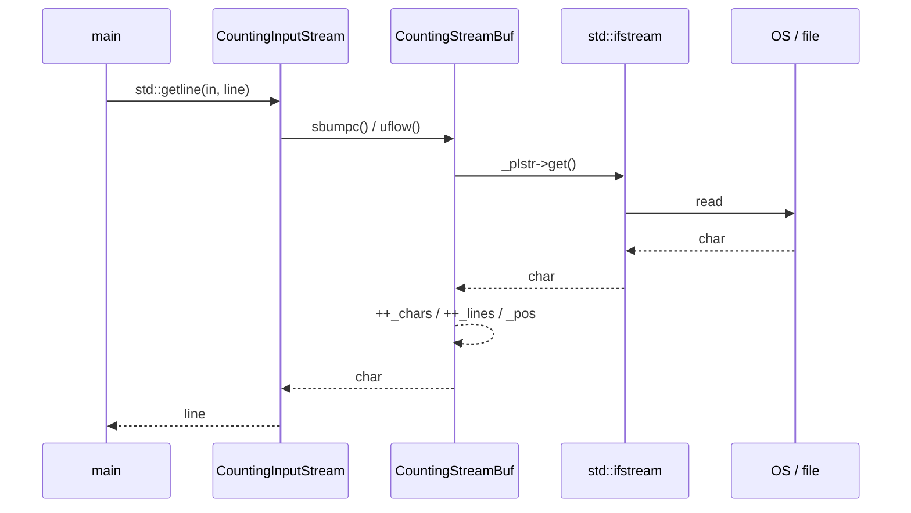

# 装饰器模式的现实软件案例：POCO `CountingInputStream`

> 案例类型：C++ 真实库  
> 模式：Decorator（装饰器）  
> 关键点：`CountingInputStream` 仍然是 `std::istream`，但给任意输入流加上字符数、行号、列号统计。

---

## 1. 为什么选这个案例

C++ 标准库没有现成的 `FilterInputStream`，但 **POCO C++ Libraries** 的 `Poco::CountingInputStream` 是一个严格同接口的流装饰器：

- 它是真实 C++ 库 `POCO` 的 `Foundation/Streams` 模块，不是教学玩具类。
- 它继承 `std::istream`，所以可以传给任何接受 `std::istream&` 的函数。
- 它只增加 `chars() / lines() / pos()`，不改变读字符的语义。
- 典型用途：词法分析器、语法分析器需要知道当前字符位置、行号、列号。

一句话：

> **用“包一层”的方式，给任意 `std::istream` 加上计数能力，而不改变它的接口。**

---

## 2. 角色映射

| 装饰器角色 | 本案例中的类型 | 说明 |
|---|---|---|
| Component（组件接口） | `std::istream` | 客户端看到的接口：`operator>>`、`std::getline`、`rdbuf()` 等 |
| ConcreteComponent（具体组件） | `std::ifstream` / `std::istringstream` | 真正提供字符的流 |
| Decorator（装饰器） | `Poco::CountingInputStream` | 本身也是 `std::istream`，同时持有计数 buffer |
| ConcreteDecorator（具体装饰器） | `Poco::CountingInputStream` | POCO 省略了抽象 Decorator 类，直接给出具体装饰器 |
| 内部转发组件 | `Poco::CountingStreamBuf` | 真正执行“读一个字符 + 计数 + 返回”的 buffer |
| 初始化辅助基类 | `Poco::CountingIOS` | 不是装饰器角色；用于保证 `_buf` 先于 `std::istream` 构造 |

> 注意：`CountingStreamBuf` 不是对外暴露的装饰器，它是装饰器内部真正干活的 buffer；  
> `CountingInputStream` 才是客户端看到的装饰器。

---

## 3. 类图



> GitHub 支持 Mermaid；如果本地编辑器不渲染，可以按下面的“逐条读图”看结构。

### 3.1 逐条读图

1. **`std::istream` 是 Component。**  
   客户端只依赖它：`std::getline(in, line)`、`in >> value`、`in.rdbuf()` 都是 `std::istream` 的接口。

2. **`std::ifstream` / `std::istringstream` 是 ConcreteComponent。**  
   它们真正提供字符；`ifstream` 从文件读，`istringstream` 从字符串读。

3. **`Poco::CountingInputStream` 是 Decorator。**  
   它继承 `std::istream`，所以装饰之后仍然是 `std::istream`；同时继承 `CountingIOS`，通过 `CountingIOS` 持有 `CountingStreamBuf _buf`。

4. **`Poco::CountingIOS` 是初始化辅助基类，不是装饰器角色。**  
   C++ 的构造顺序是“基类先于成员”。`std::istream` 需要一个已经构造好的 `std::streambuf`，但 `_buf` 是成员，不能先于基类构造。  
   POCO 用 `CountingIOS` 先持有 `_buf`，再让 `std::istream` 绑定 `&_buf`：
   ```cpp
   CountingInputStream::CountingInputStream(std::istream& istr)
       : CountingIOS(istr), std::istream(&_buf) {}
   ```
   这是 C++ 实现装饰器时非常典型的“工程细节”。

5. **`CountingStreamBuf` 是内部转发组件。**  
   它继承 `UnbufferedStreamBuf`（最终继承 `std::streambuf`），持有一个 `std::istream* _pIstr` 指向原始流。  
   它实现 `readFromDevice()`：读一个字符、计数、返回。

6. **`CountingStreamBuf` 和原始 `std::istream` 是“委托”关系。**  
   `_pIstr->get()` 把读请求交给原始流；`return c` 把结果原样返回。  
   新增的只有 `++_chars`、`++_lines`、`_pos` 这些计数副作用。

7. **为什么不是直接 `std::istream*` 成员？**  
   `CountingInputStream` 公开继承 `std::istream`，而 `std::istream` 的实际读取工作由 `std::streambuf` 完成。  
   所以 POCO 把“持有原流”放在 `CountingStreamBuf` 里：`CountingInputStream` 持有 `CountingIOS`，`CountingIOS` 持有 `CountingStreamBuf`，`CountingStreamBuf` 持有原始 `std::istream*`。  
   这是“两级持有”，但装饰器结构仍然成立：**同一接口 + 持有 + 委托 + 加行为**。

### 3.2 关系总结

```text
CountingInputStream  ──is-a──▶  std::istream
        │
        └──is-a──▶ CountingIOS ──contains──▶ CountingStreamBuf ──delegates──▶ 原始 std::istream
```

- **is-a**：`CountingInputStream` 是 `std::istream`，所以客户端可以透明使用。
- **has-a**：`CountingIOS` 内含 `CountingStreamBuf _buf`。
- **delegates**：`CountingStreamBuf::readFromDevice()` 调用 `_pIstr->get()`。
- **adds behavior**：在委托前后维护 `_chars`、`_lines`、`_pos`。

---

## 4. 调用链



### 4.1 文字版

1. `std::getline(in, line)` 的形参是 `std::istream&`，`in` 的实际类型是 `CountingInputStream`。
2. `getline` 通过 `std::streambuf` 接口取字符；这个 buffer 是 `CountingStreamBuf`。
3. `CountingStreamBuf::readFromDevice()` 调用 `_pIstr->get()`，把请求转发给原始 `std::ifstream`。
4. 原始流从文件读一个字符并返回。
5. `CountingStreamBuf` 在返回前执行 `++_chars`，并维护行号、列号。
6. 字符沿原路返回；`getline` 拼成一行。接口和返回语义完全没变。

---

## 5. C++ 代码

### 5.1 真实库用法

```cpp
#include <Poco/CountingStream.h>

#include <fstream>
#include <iostream>
#include <string>

int main() {
    std::ifstream file("input.txt");
    if (!file) {
        std::cerr << "cannot open input.txt\n";
        return 1;
    }

    Poco::CountingInputStream in(file);

    std::string line;
    while (std::getline(in, line)) {
        std::cout << line << '\n';
    }

    std::cout << "chars=" << in.chars()
              << " lines=" << in.lines()
              << " pos="   << in.pos()   << '\n';
}
```

关键点：

- `Poco::CountingInputStream in(file);`：包住 `file`，但 `in` 仍然是 `std::istream`。
- `std::getline(in, line)`：完全不用改，因为形参就是 `std::istream&`。
- `in.chars()`、`in.lines()`、`in.pos()`：装饰器新增的计数接口。

完整文件：[`code/poco_counting_demo.cpp`](code/poco_counting_demo.cpp)

### 5.2 POCO 源码关键片段

`Poco/CountingStream.h`（节选，保留核心关系）：

```cpp
class Foundation_API CountingStreamBuf : public UnbufferedStreamBuf {
public:
    explicit CountingStreamBuf(std::istream& istr);
    int chars() const;
    int lines() const;
    int pos() const;

protected:
    int readFromDevice();
    int writeToDevice(char c);

private:
    std::istream* _pIstr = nullptr;
    std::ostream* _pOstr = nullptr;
    int _chars = 0;
    int _lines = 0;
    int _pos = 0;
};

class Foundation_API CountingIOS : public virtual std::ios {
public:
    explicit CountingIOS(std::istream& istr);
    int chars() const;
    int lines() const;
    int pos() const;

protected:
    CountingStreamBuf _buf;
};

class Foundation_API CountingInputStream : public CountingIOS, public std::istream {
public:
    explicit CountingInputStream(std::istream& istr);
    ~CountingInputStream();
};
```

`Poco/CountingStream.cpp`（节选）：

```cpp
CountingInputStream::CountingInputStream(std::istream& istr)
    : CountingIOS(istr), std::istream(&_buf) {
}

int CountingStreamBuf::readFromDevice() {
    if (_pIstr) {
        int c = _pIstr->get();       // 1. 委托
        if (c != -1) {
            ++_chars;                // 2. 字符计数
            if (_pos++ == 0) ++_lines; // 3. 行首
            if (c == '\n') _pos = 0;   // 4. 行尾
        }
        return c;                    // 5. 返回语义不变
    }
    return -1;
}
```

### 5.3 不用 POCO 的最小复刻

下面这份代码不依赖 POCO，用 `std::streambuf` 复刻同样的结构，便于本地验证：

```cpp
#include <iostream>
#include <sstream>
#include <streambuf>
#include <string>

class CountingBuf : public std::streambuf {
public:
    explicit CountingBuf(std::streambuf* src) : src_(src) {}

    std::streamsize chars() const { return chars_; }
    std::streamsize lines() const { return lines_; }
    std::streamsize pos() const { return pos_; }

protected:
    int_type underflow() override {
        return src_->sgetc();
    }

    int_type uflow() override {
        int_type c = src_->sbumpc();
        if (!traits_type::eq_int_type(c, traits_type::eof())) {
            char ch = traits_type::to_char_type(c);
            ++chars_;
            if (pos_++ == 0) ++lines_;
            if (ch == '\n') pos_ = 0;
        }
        return c;
    }

    std::streamsize xsgetn(char* s, std::streamsize n) override {
        std::streamsize done = 0;
        while (done < n) {
            int_type c = uflow();
            if (traits_type::eq_int_type(c, traits_type::eof())) break;
            s[done++] = traits_type::to_char_type(c);
        }
        return done;
    }

private:
    std::streambuf* src_;
    std::streamsize chars_ = 0;
    std::streamsize lines_ = 0;
    std::streamsize pos_ = 0;
};

class CountingInputStream : public std::istream {
public:
    explicit CountingInputStream(std::istream& in)
        : std::istream(nullptr), buf_(in.rdbuf()) {
        rdbuf(&buf_);
        clear();
    }

    std::streamsize chars() const { return buf_.chars(); }
    std::streamsize lines() const { return buf_.lines(); }
    std::streamsize pos() const { return buf_.pos(); }

private:
    CountingBuf buf_;
};

int main() {
    std::istringstream src("hello\nworld\n");
    CountingInputStream in(src);

    std::string line;
    while (std::getline(in, line)) {
        std::cout << "[" << line << "]\n";
    }

    std::cout << "chars=" << in.chars()
              << " lines=" << in.lines()
              << " pos="   << in.pos()   << '\n';
}
```

输出：

```text
[hello]
[world]
chars=12 lines=2 pos=0
```

完整文件：[`code/counting_stream.cpp`](code/counting_stream.cpp)

---

## 6. 为什么它是 Decorator，而不是 Adapter？

```text
Adapter：std::istream → std::istream_iterator<int> → InputIterator
         接口改变（流 → 迭代器）

Decorator：std::istream → CountingInputStream → std::istream
         接口不变（仍然是 istream）
```

判断标准：

> **接口有没有变？**  
> 变了是 Adapter；没变，并且“持有 + 委托 + 加行为”，才是 Decorator。

`std::istream_iterator<int>` 是典型的 Adapter：它把流适配成迭代器，接口从“流”变成“迭代器”。  
`CountingInputStream` 仍然是 `std::istream`，所以 `std::getline` 不用改。

---

## 7. 代价与边界

| 代价 | 具体表现 | 应对 |
|---|---|---|
| 生命周期 | `CountingStreamBuf` 只保存原始 `std::istream*`，不拥有它 | 原 stream 必须活得比装饰器久；不要装饰临时对象 |
| 类型身份 | `dynamic_cast<std::ifstream*>(&in)` 会失败 | 需要原流时保留引用，不要依赖具体类型 |
| 顺序 | 多个装饰器叠加时，顺序会改变行为 | 把顺序当成设计的一部分 |
| 性能 | `UnbufferedStreamBuf` 逐字符调用 `readFromDevice` | 高吞吐 I/O 先包一层缓冲，或换实现 |
| 计数范围 | POCO 用 `int` 计数 | 超大流注意溢出；需要时用 64 位计数 |
| 线程安全 | 本身不保证 | 多线程各自持有，或外部加锁 |

---

## 8. 编译与运行

### POCO 版本

```powershell
vcpkg install poco
g++ -std=c++17 poco_counting_demo.cpp -lPocoFoundation -o poco_demo
.\poco_demo
```

`input.txt`：

```text
hello
world
```

### 无 POCO 版本

```powershell
g++ -std=c++17 -Wall -Wextra counting_stream.cpp -o counting_stream
.\counting_stream
```

---

## 9. 讲解时怎么用类图

答辩/汇报时可以按这个顺序讲：

1. **先指 Component**：`std::istream`，客户端只认它。
2. **再指 ConcreteComponent**：`std::ifstream`，真正提供字符。
3. **再指 Decorator**：`CountingInputStream`，它也是 `std::istream`，所以能透明替换。
4. **把 `CountingIOS` 解释成“初始化辅助基类”**，不是装饰器角色；它负责让 `_buf` 先构造。
5. **指 `CountingStreamBuf`**：真正转发和计数的地方，持有原始 `std::istream*`。
6. **最后指 `readFromDevice()`**：`_pIstr->get()` 是委托，`++_chars` 是新增行为，`return c` 是保持接口。

一句话收尾：

> **`CountingInputStream` 用“包一层”给任意 `istream` 加上 chars/lines/pos，而不改变它的接口。**

---

## 10. 参考资料

- GoF《设计模式》4.4 Decorator，pp.115–120
- Head First 设计模式 第 3 章，pp.79–105
- POCO `CountingStream.h` / `CountingStream.cpp`
- POCO 文档：<https://docs.pocoproject.org/current/Poco.CountingInputStream.html>
- C++ 标准库 `std::istream` / `std::streambuf`
