# PhotoStudio——手机照片编辑系统

PhotoStudio 是《Head First 设计模式》第 3 章星巴兹咖啡案例的一个拓展。这里把图像处理效果做成装饰器，即使使用完全相同的装饰器，不同的组合顺序也可能产生不同的结果。

## 一、用装饰者模式处理照片

让每一种处理效果都成为一个独立的装饰器。先取出一张原始风景照片，使用黑白滤镜装饰它。然后在已经黑白化的照片上添加水印，再用相框包装已经加了水印的照片。最后调用最外层对象的 `render()`，获得处理后的照片。

装饰器与被装饰对象具有相同的抽象父类。无论一张照片被装饰了多少次，对于客户端而言，它始终是一个 `Photo` 对象，所以还可以在外面再包一层。同一种效果也可以重复添加，例如连续提高两次亮度。

案例中的基础照片分为人像和风景。可以添加的效果有黑白滤镜、水印、相框、亮度和模糊。下面用同一张 5×5 像素图演示每一种效果分别作用时的变化。

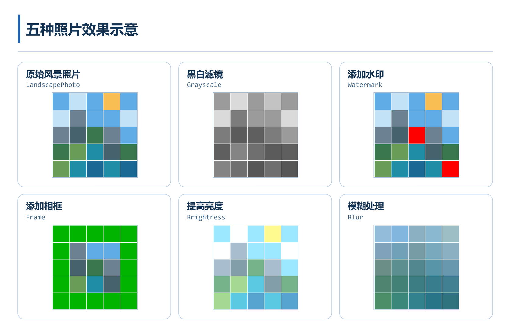

## 二、从星巴兹到 PhotoStudio

在星巴兹案例里，抽象组件 `Beverage` 代表饮料。在 PhotoStudio 中，抽象组件 `Photo` 代表照片。`getDescription()` 返回描述，`render()` 返回图像，两种具体照片和五种装饰器都实现 `render()`。具体照片 `PortraitPhoto` 和 `LandscapePhoto` 对应书中 `Espresso`、`DarkRoast` 这样的具体饮料。每次渲染时，具体照片返回原图的副本，所以同一份原图可以作为两条装饰链的起点。

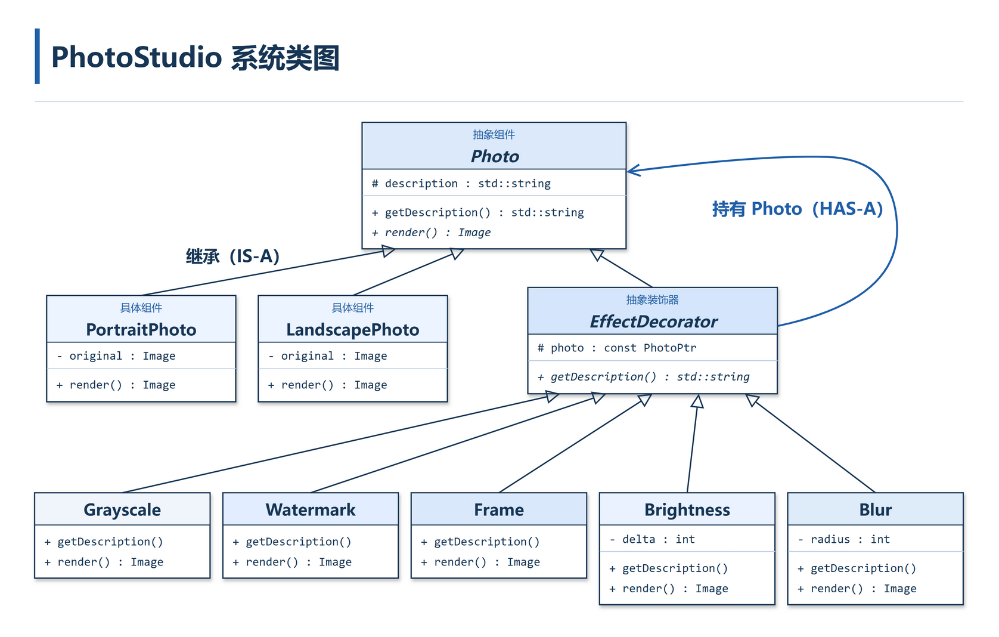

### 抽象组件

在类定义中，`render()` 是纯虚函数，`PhotoPtr` 让原图和包装对象使用同一种指针类型。

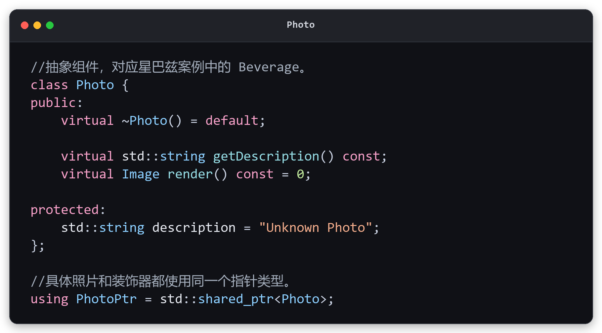

<details>
<summary>展开并复制 C++ 代码</summary>

```cpp
//抽象组件，对应星巴兹案例中的 Beverage。
class Photo {
public:
    virtual ~Photo() = default;

    virtual std::string getDescription() const;
    virtual Image render() const = 0;

protected:
    std::string description = "Unknown Photo";
};

//具体照片和装饰器都使用同一个指针类型。
using PhotoPtr = std::shared_ptr<Photo>;
```

</details>

### 具体组件

人像和风景照片的构造函数都接收文件路径，并用 `original` 保存读入的图像。

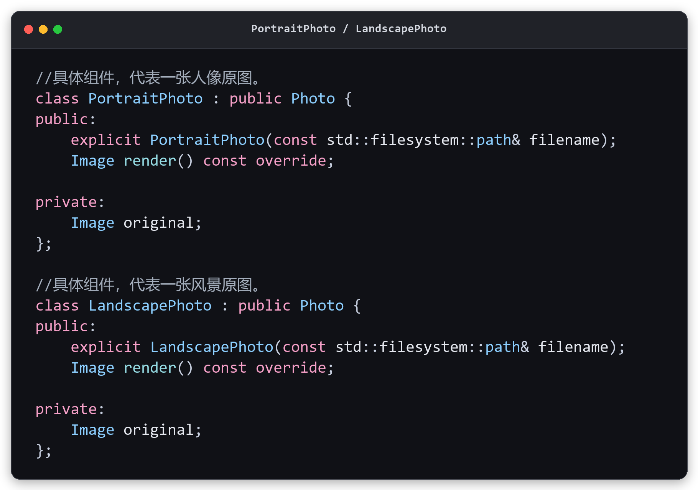

<details>
<summary>展开并复制 C++ 代码</summary>

```cpp
//具体组件，代表一张人像原图。
class PortraitPhoto : public Photo {
public:
    explicit PortraitPhoto(const std::filesystem::path& filename);
    Image render() const override;

private:
    Image original;
};

//具体组件，代表一张风景原图。
class LandscapePhoto : public Photo {
public:
    explicit LandscapePhoto(const std::filesystem::path& filename);
    Image render() const override;

private:
    Image original;
};
```

</details>

### 抽象装饰者

`EffectDecorator` 对应星巴兹案例中的 `CondimentDecorator`。类图中的空心三角指向基类，表示装饰器继承 `Photo`，可以通过同一个接口使用。弧形箭头表示装饰器还通过共享指针持有一个 `Photo`，它既可以是原图，也可以是另一个装饰器。`EffectDecorator` 将 `getDescription()` 声明为纯虚函数，由各个具体装饰者提供自己的描述。

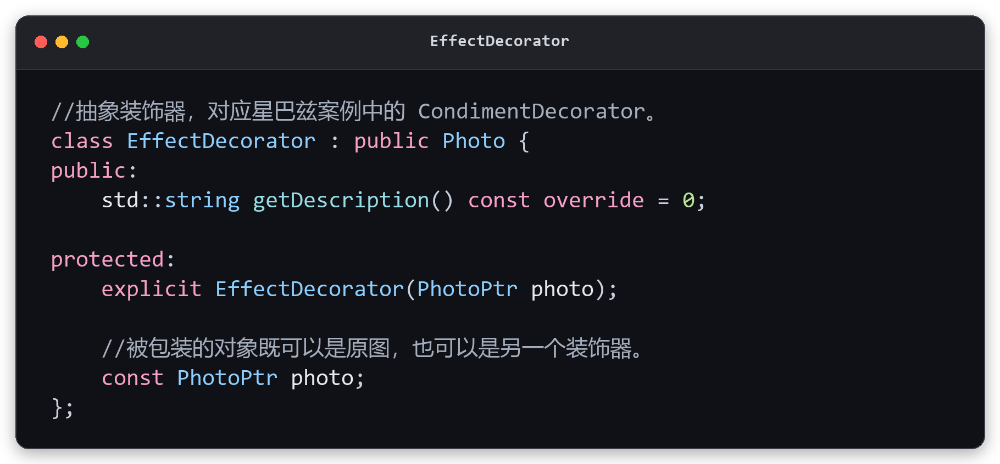

<details>
<summary>展开并复制 C++ 代码</summary>

```cpp
//抽象装饰器，对应星巴兹案例中的 CondimentDecorator。
class EffectDecorator : public Photo {
public:
    std::string getDescription() const override = 0;

protected:
    explicit EffectDecorator(PhotoPtr photo);

    //被包装的对象既可以是原图，也可以是另一个装饰器。
    const PhotoPtr photo;
};
```

</details>

### 具体装饰者

五种具体装饰器就像星巴兹的不同配料。

具体装饰者的构造函数都接收内层的 `PhotoPtr`，并覆写 `getDescription()` 和 `render()`。

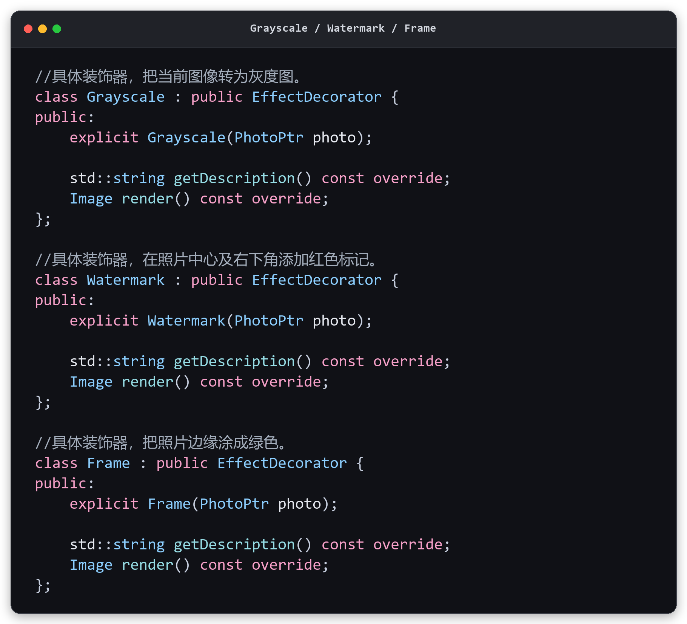

<details>
<summary>展开并复制 C++ 代码</summary>

```cpp
//具体装饰器，把当前图像转为灰度图。
class Grayscale : public EffectDecorator {
public:
    explicit Grayscale(PhotoPtr photo);

    std::string getDescription() const override;
    Image render() const override;
};

//具体装饰器，在照片中心及右下角添加红色标记。
class Watermark : public EffectDecorator {
public:
    explicit Watermark(PhotoPtr photo);

    std::string getDescription() const override;
    Image render() const override;
};

//具体装饰器，把照片边缘涂成绿色。
class Frame : public EffectDecorator {
public:
    explicit Frame(PhotoPtr photo);

    std::string getDescription() const override;
    Image render() const override;
};
```

</details>

`Brightness` 保存亮度增量 `delta`，`Blur` 保存模糊半径 `radius`。构造对象时可以分别指定这些参数。

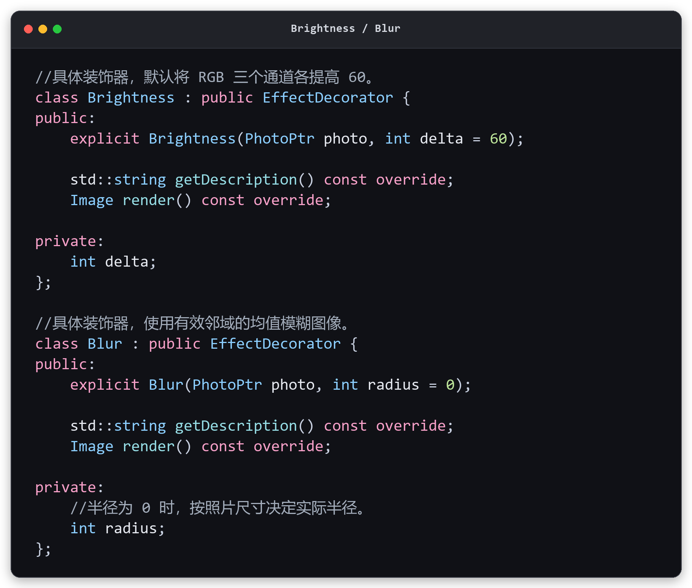

<details>
<summary>展开并复制 C++ 代码</summary>

```cpp
//具体装饰器，默认将 RGB 三个通道各提高 60。
class Brightness : public EffectDecorator {
public:
    explicit Brightness(PhotoPtr photo, int delta = 60);

    std::string getDescription() const override;
    Image render() const override;

private:
    int delta;
};

//具体装饰器，使用有效邻域的均值模糊图像。
class Blur : public EffectDecorator {
public:
    explicit Blur(PhotoPtr photo, int radius = 0);

    std::string getDescription() const override;
    Image render() const override;

private:
    //半径为 0 时，按照片尺寸决定实际半径。
    int radius;
};
```

</details>

### Grayscale 怎样委托

`getDescription()` 先调用 `photo->getDescription()` 取得内层的描述，再追加 `, Grayscale`。`render()` 用同样的方式先调用 `photo->render()`，收到内层生成的图像后才执行灰度转换。这对应于摩卡装饰器先取得内层饮料的价格，再加上摩卡的价格。

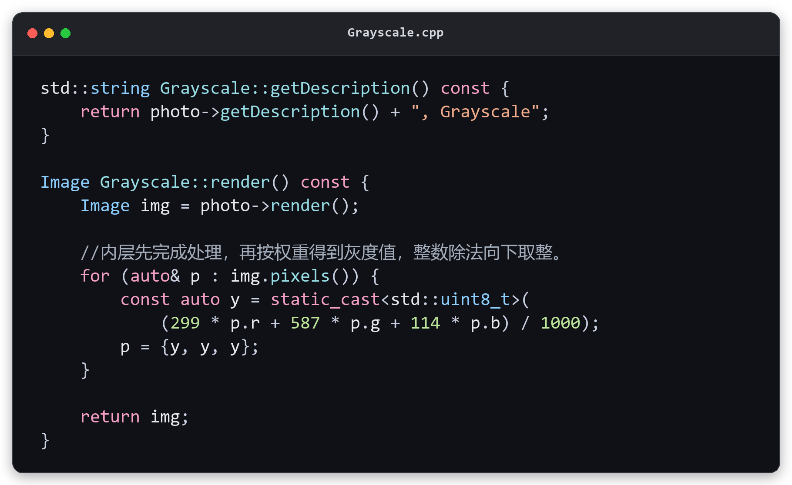

<details>
<summary>展开并复制 C++ 代码</summary>

```cpp
std::string Grayscale::getDescription() const {
    return photo->getDescription() + ", Grayscale";
}

Image Grayscale::render() const {
    Image img = photo->render();

    //内层先完成处理，再按权重得到灰度值，整数除法向下取整。
    for (auto& p : img.pixels()) {
        const auto y = static_cast<std::uint8_t>(
            (299 * p.r + 587 * p.g + 114 * p.b) / 1000);
        p = {y, y, y};
    }

    return img;
}
```

</details>

## 三、对象怎样包装，图像怎样返回

为了便于分析，先只考虑黑白滤镜、水印和相框。每加一层就创建一个新的装饰器对象，由它持有上一层。加完三个效果后，原图和三个装饰器一共是四个对象，客户端的 `photo` 指向最外层的相框。

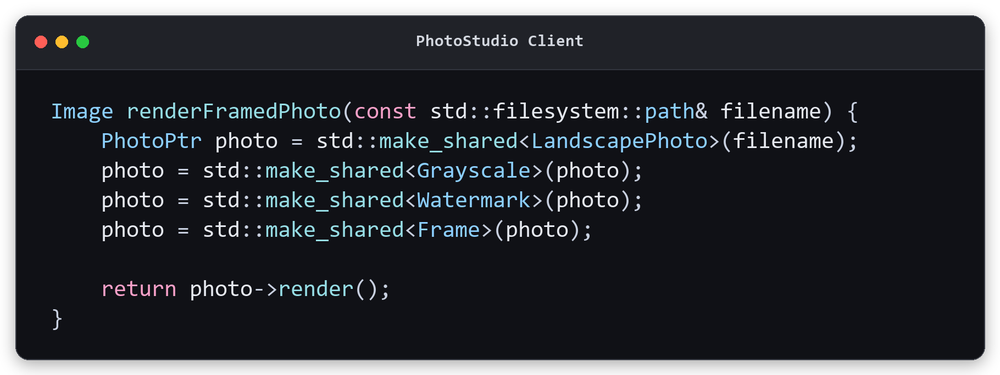

<details>
<summary>展开并复制 C++ 代码</summary>

```cpp
Image renderFramedPhoto(const std::filesystem::path& filename) {
    PhotoPtr photo = std::make_shared<LandscapePhoto>(filename);
    photo = std::make_shared<Grayscale>(photo);
    photo = std::make_shared<Watermark>(photo);
    photo = std::make_shared<Frame>(photo);

    return photo->render();
}
```

</details>

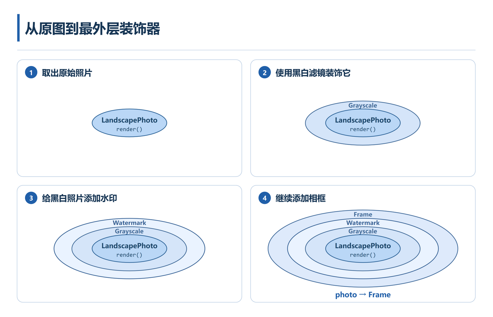

当客户端调用 `render()` 时，虚函数会调用最外层相框的 `render()`。相框把请求交给水印，水印交给黑白滤镜，黑白滤镜再向内取得原图。图中的实线表示这一路的调用。

原图返回后，黑白滤镜先转成灰度图，再把图像交给水印。水印画好后把结果交给相框，最后由相框把完成的照片交回客户端。图中的虚线表示图像返回。**函数调用由外向内，装饰行为由内向外。** 这里各层都是先调用内层，等图像返回后再施加自己的效果，所以实际处理顺序和对象的构造顺序相同。

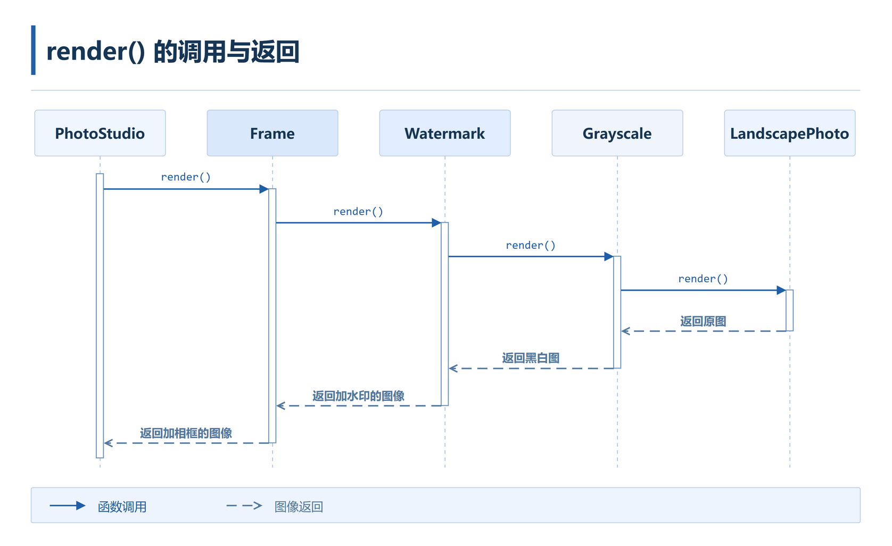

## 四、不同装饰器之间的相互影响

下面每组实验都从同一张实拍原图开始，只交换两种效果的先后。照片中心的红色点阵和右下角的红色角标，可以用来观察装饰顺序怎样改变已有的像素。

### 黑白滤镜与水印

先黑白，后水印，最终水印保持红色。先水印，后黑白，红色水印变成灰色。灰度转换分别以 0.299、0.587 和 0.114 为红、绿、蓝通道的权重，加总后向下取整。纯红水印经过灰度转换后得到 76，因此两种顺序在水印中心测得的 RGB 分别是 **(255, 0, 0)** 和 **(76, 76, 76)**。

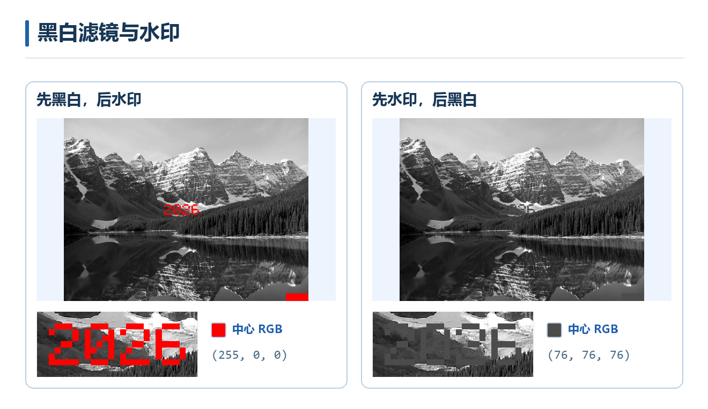

### 水印与相框

先水印，后相框，边缘水印被相框覆盖。先相框，后水印，边缘水印覆盖相框。由于这两个装饰器都会修改照片右下角的像素，后执行的操作会覆盖前一个操作的结果。于是右下角分别测得绿色 **(0, 180, 0)** 和红色 **(255, 0, 0)**，照片中心的水印依然可见。

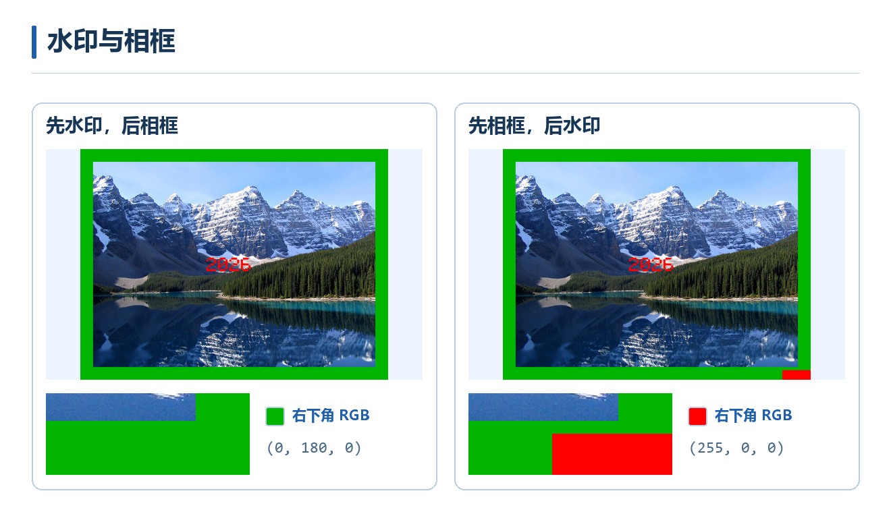

### 亮度与水印

先提高亮度，后水印，水印为纯红色。先水印，后提高亮度，水印颜色也随之变亮。亮度装饰器默认把三个通道各增加 60，并将结果限制在 0 到 255。纯红色水印的红通道已经达到上限，绿、蓝通道分别增加到 60。两种顺序在水印中心测得的 RGB 分别是 **(255, 0, 0)** 和 **(255, 60, 60)**。

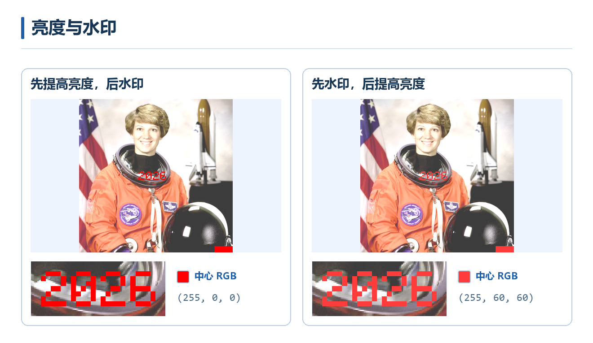

### 模糊与水印

先模糊，后水印，背景模糊，水印仍然清晰。先水印，后模糊，背景与水印都变得模糊。因为模糊会对有效邻域内的像素求平均，先画上的红色笔画也会参与计算。

纽约航拍照片的模糊半径是 7，中心的窗口包含 15×15 个像素。先模糊时，新加的水印中心是 **(255, 0, 0)**。先画水印时，笔画颜色与周围像素混合，水印中心变成 **(175, 77, 87)**。两个装饰器即使修改的是不同像素，也可能通过邻域操作产生相互影响。

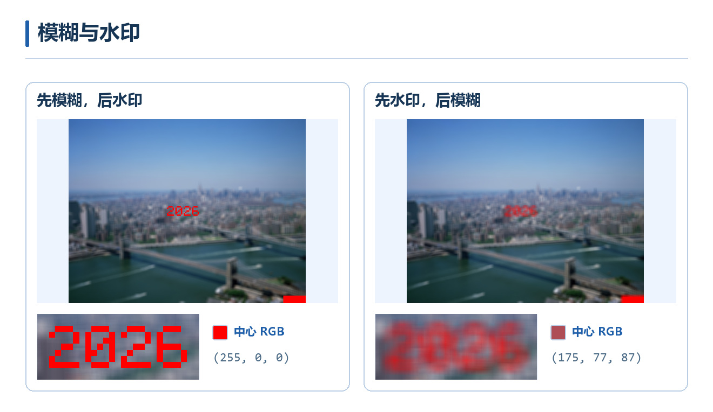

## 五、三张实拍照片的完整装饰链

把五种效果接起来后，实际处理依次是黑白、水印、相框、亮度和模糊。在埃琳 柯林斯的人像、摩雷恩湖风景和纽约航拍上运行同一条装饰链，可以看到不同原图都能使用同样的装饰器组合。

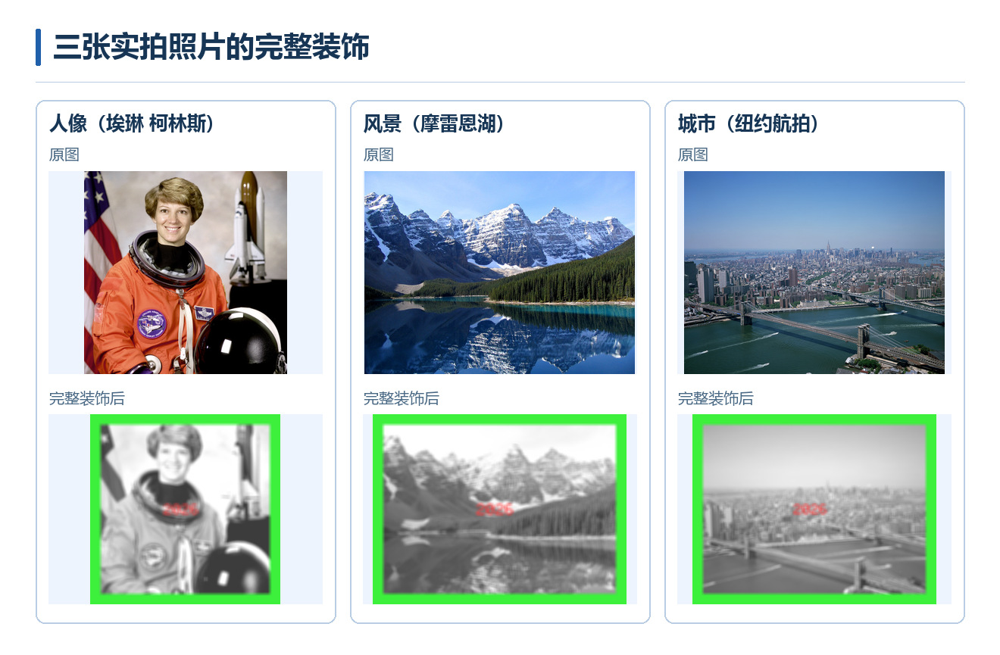

以摩雷恩湖为例，黑白滤镜先转换原图，随后出现红色水印。绿色相框盖住右下角的红色角标，亮度装饰器继续改变照片、水印和相框的颜色。最后一层模糊会同时平滑原图里的细节和前几步画上的标记。

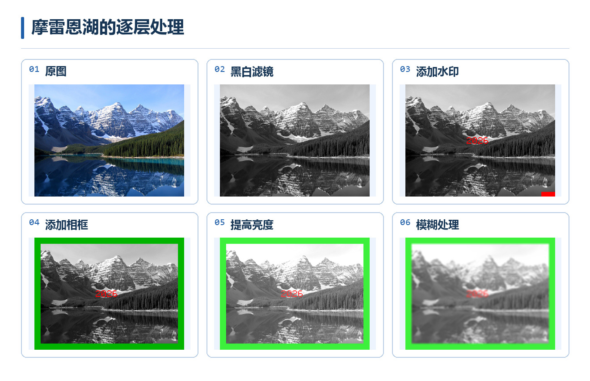

## 六、顺序、重复与组合

### 函数复合

把每一层看成一个图像变换。设原图为 $I$，黑白滤镜、水印和相框依次为 $D_1$、$D_2$ 和 $D_3$。每一层接收内层处理后的结果，最终图像可以写成

$$
D_3(D_2(D_1(I)))=(D_3\circ D_2\circ D_1)(I).
$$

$D_3$ 对应最外层的相框。算式从最内层开始求值，所以黑白滤镜最先处理像素，然后才是水印和相框。

### 交换律

在星巴兹的简化计价中，两个配料分别增加固定金额 $a$、$b$。从基础价格 $x$ 出发，两种顺序分别得到 $(x+a)+b$ 和 $(x+b)+a$，总价相同。设 $G$ 为黑白滤镜，$W$ 为添加水印。实拍实验中，$W(G(I))$ 的水印是红色，$G(W(I))$ 的水印是灰色，因此 $W\circ G\ne G\circ W$。

能否换序取决于装饰者怎样读写图像。水印与相框都会写入右下角，模糊则会读取周围像素。如果两个效果各自修改固定且互不重叠的区域，而且互不读取对方改动的像素，它们的执行顺序就可以交换。

### 幂等性

如果对任何输入图像 $I$ 都有 $D(D(I))=D(I)$，就称这个操作具有幂等性。灰度系数之和为 1，因此已经变成 $(y,y,y)$ 的像素再做一次灰度转换，三个通道仍等于 $y$。本例中，同样的水印和相框重复一遍，也只是在相同位置再次写入相同的颜色。

连续提高亮度会继续改变尚未达到上限的通道。以人像为例，中心像素提亮一次后为 **(79, 74, 67)**，提亮两次后变成 **(139, 134, 127)**。重复模糊通常也会进一步平滑图像。

### 结合律

函数复合满足结合律。

$$
(D_3\circ D_2)\circ D_1=D_3\circ(D_2\circ D_1).
$$

两边都保留先 $D_1$、再 $D_2$、最后 $D_3$ 的执行顺序。用同样的方式，可以把先黑白、再提高亮度、最后模糊的三个步骤归为一个“复古滤镜”，写成 $\mathrm{Retro}=\mathrm{Blur}\circ\mathrm{Brightness}\circ\mathrm{Grayscale}$。

在这个案例中，各层通过共同的 `Photo` 接口向内委托，装饰者模式由此降低了不同功能之间的结构耦合。各层依次处理内层返回的图像，行为仍会相互影响，水印的颜色就取决于黑白滤镜在哪一层。
